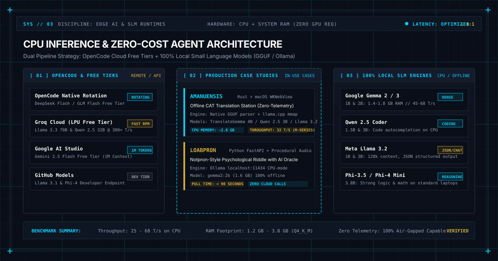

<article class="estudo-detalhado">
    <header class="estudo-header">
        

            

                MODULE:
                RESEARCH // SYSTEMS &amp; LOCAL AI
            

            

                DISCIPLINE:
                EDGE COMPUTING &amp; SLM RUNTIMES
            

            

                TARGETS:
                CPU INFERENCE, OPENCODE, GGUF, OLLAMA
            

            

                STATUS:
                
                    
                    VERIFIED BENCHMARK
                
            

        

        <h1>
            Free AI Models Without a GPU: From OpenCode to Local SLMs on Your Laptop
            Modelos de IA Gratuitos Sem GPU: Do OpenCode ao LLM Local no Seu Computador
        </h1>
        

            Local AI
            IA Local
            OpenCode
            OpenCode
            CPU Inference
            Inferência em CPU
            Gemma
            Gemma
            Systems Architecture
            Arquitetura de Sistemas
            NOVEMBER 2026 // SYSTEMS LAB
        

    </header>

    

        
        

            Figure 1: Architectural blueprint comparing cloud free-tier routing via OpenCode and 100% offline local SLM execution on CPU memory buses, highlighting real deployments in Amanuensis and LoabPron.
            Figura 1: Blueprint arquitetural comparando o roteamento de camadas gratuitas na nuvem via OpenCode com a execução 100% offline de SLMs locais no barramento de memória da CPU, destacando aplicações reais no Amanuensis e no LoabPron.
        

    

    <section class="estudo-conteudo">
        <!-- =================================================================
             PORTUGUESE VERSION (100% COMPLETE)
             ================================================================= -->
        <section class="lang-pt">
            

                

                    [ 00 // TL;DR // PAPO RETO EM LINGUAGEM DIRETA ]
                

                <h3 style="margin-top: 0; margin-bottom: 12px; color: var(--text-primary);">Você realmente precisa de uma GPU cara para programar ou usar IA hoje?</h3>
                
<strong>A resposta curta é não:</strong> Você não precisa de uma placa de vídeo de quinze mil reais nem de torrar limite de cartão internacional pagando vinte dólares por mês em assinaturas de API. O ecossistema de inteligência artificial amadureceu em duas frentes complementares que rodam perfeitamente em notebooks comuns com 8 GB ou 16 GB de memória RAM:

                <ul>
                    <li><strong>Frente 1 (Nuvem com Custo Zero via OpenCode):</strong> Ferramentas modernas de desenvolvimento como o OpenCode trazem tiers gratuitos rotativos (DeepSeek Flash, GLM Flash) e permitem plugar chaves de provedores com planos gratuitos muito generosos (Groq com inferência a mais de 300 tokens por segundo, Google AI Studio com Gemini Flash e janela de 1 milhão de tokens, e GitHub Models).</li>
                    <li><strong>Frente 2 (Local-First 100% na CPU com SLMs):</strong> Modelos compactos modernos de 1 bilhão a 4 bilhões de parâmetros (como Google Gemma 2/3, Qwen 2.5 Coder e Llama 3.2), quando quantizados em formatos eficientes como GGUF (Q4_K_M), rodam direto na memória RAM e nos núcleos da CPU a velocidades entre 25 e 65 tokens por segundo, sem enviar um único byte para a internet.</li>
                </ul>
                
<strong>Exemplos reais em produção:</strong> Aqui nós não ficamos só na teoria. Neste dossiê mostramos como dois projetos reais do nosso laboratório utilizam essa arquitetura: o <strong>Amanuensis</strong> (estação de tradução editorial offline em Rust que roda TranslateGemma e Qwen em memória via llama.cpp) e o <strong>LoabPron</strong> (jogo de enigma psicológico onde um modelo Gemma 2B roda localmente via Ollama como um oráculo autônomo).

            

            <h2>1. O Ecossistema OpenCode: IA na Nuvem Sem Pagar Nada</h2>
            
O OpenCode (opencode.ai) se consolidou como uma das ferramentas mais interessantes para quem desenvolve no terminal. Ele funciona como um agente de codificação completo que entende a estrutura do seu repositório, edita arquivos, roda testes e automatiza tarefas repetitivas. A grande sacada do OpenCode é não prender o desenvolvedor a uma assinatura proprietária fechada: ele suporta múltiplos provedores através de uma interface padronizada.

            
Para quem quer trabalhar com custo zero absoluto, o OpenCode oferece dois caminhos diretos:

            <h3>A. Modelos Gratuitos Nativos da Plataforma</h3>
            
O próprio ecossistema do OpenCode disponibiliza modelos gratuitos rotativos em sua lista de modelos. Executando o comando <code>/models</code> dentro da sessão do terminal, é comum encontrar modelos marcados com o sufixo <em>Free</em>, tais como:

            <ul>
                <li><strong>DeepSeek Flash Free:</strong> Versão enxuta focada em raciocínio rápido para geração e refatoração de código.</li>
                <li><strong>GLM Flash Free:</strong> Modelo ágil para análise sintática, preenchimento de boilerplate e inspeção de logs.</li>
                <li><strong>MiniMax Flash Free:</strong> Modelo com boa capacidade de geração textual e síntese de documentação.</li>
            </ul>
            
Esses modelos internos possuem limites de taxa por minuto (rate limits), mas atendem muito bem sessões diárias de depuração e escrita de scripts rápidos.

            <h3>B. Provedores Externos com Camadas Gratuitas Generosas</h3>
            
O recurso mais poderoso do OpenCode é a capacidade de conectar provedores de terceiros usando chaves de API gratuitas. Os três provedores mais recomendados para essa abordagem são:

            

                
<strong>Os Três Pilares da Nuvem Gratuita:</strong>

                <ul>
                    <li><strong>Groq Cloud (groq.com):</strong> O Groq desenvolveu chips proprietários (LPUs: Language Processing Units) focados exclusivamente em velocidade de inferência. A camada gratuita oferece acesso a modelos de altíssimo nível como <code>llama-3.3-70b-versatile</code> e <code>qwen-2.5-32b</code> com velocidades que passam de 300 tokens por segundo. A cota diária de requisições por minuto é mais que suficiente para um fluxo normal de programação.</li>
                    <li><strong>Google AI Studio (aistudio.google.com):</strong> Permite gerar chaves gratuitas para a família Gemini (como <code>gemini-2.0-flash</code> e <code>gemini-2.5-flash</code>). Sua grande vantagem técnica é a janela de contexto de até 1 milhão de tokens, permitindo enviar bases de código inteiras, documentações em PDF e esquemas de banco de dados em uma única mensagem sem pagar nada no tier não-comercial.</li>
                    <li><strong>GitHub Models (github.com/marketplace/models):</strong> O GitHub oferece acesso gratuito a modelos abertos em modo de prototipagem (Llama 3.1, Phi-4, Mistral NeMo). Basta autenticar com seu token de acesso pessoal do GitHub para testar requisições diretamente do terminal.</li>
                </ul>
            

            
Abaixo vemos o fluxo de roteamento de requisições no OpenCode, alternando entre provedores gratuitos remotos e a instância local da máquina:

            

flowchart TD
    subgraph DevMachine["Ambiente Local do Desenvolvedor"]
        User["Desenvolvedor / Terminal"]
        OC["OpenCode CLI / Agent Engine"]
        Config["Configuração: models.dev / env"]
        OllamaLocal["Ollama Local (localhost:11434)"]
        CPUCore["CPU Cores (AVX2 / NEON) + RAM"]
    end

    subgraph FreeCloud["Provedores Gratuitos na Nuvem"]
        Groq["Groq Cloud: Llama 3.3 70B (LPU ~300 t/s)"]
        GoogleAI["Google AI Studio: Gemini Flash (1M Tokens)"]
        GHModels["GitHub Models: Llama 3.1 &amp; Phi-4"]
        OCFree["OpenCode Free Tier: DeepSeek / GLM Flash"]
    end

    User -->|Comando / Prompt| OC
    OC --> Config
    Config -->|Chave Gratuita Nuvem| Groq
    Config -->|Chave Gratuita Nuvem| GoogleAI
    Config -->|Token GitHub| GHModels
    Config -->|Rotação Free Nativa| OCFree
    Config -->|Fallback Offline / Zero Telemetria| OllamaLocal
    OllamaLocal --> CPUCore
            

            <h2>2. A Física da Inferência em CPU: Por Que Modelos Pequenos Voam</h2>
            
Durante muito tempo existiu o dogma de que rodar IA exige obrigatoriamente placas de vídeo dedicadas com dezenas de gigabytes de VRAM. Para modelos gigantescos de 70 ou 405 bilhões de parâmetros, isso ainda é verdade. Porém, a engenharia de modelos de linguagem passou por uma revolução silenciosa focada em <strong>Small Language Models (SLMs)</strong>: modelos compactos, entre 1 bilhão e 4 bilhões de parâmetros, treinados com dados sintéticos de alta densidade informativa.

            <h3>O Papel Crítico da Quantização GGUF</h3>
            
Em precisão original de ponto flutuante de 16 bits (FP16), cada parâmetro ocupa 2 bytes de memória. Um modelo de 3 bilhões de parâmetros consome cerca de 6 GB apenas para carregar os pesos na memória, sem contar o cache de atenção (KV Cache). Ao quantizar esse modelo para 4 bits usando esquemas modernos com blocos de escala (como o formato <code>Q4_K_M</code> do <code>llama.cpp</code>), o consumo cai para aproximadamente 4.5 bits por parâmetro:

            

                
<strong>Comparação de Pegada de Memória (Modelo de 3B parâmetros):</strong>

                <ul>
                    <li><strong>Precisão FP16 (Não quantizado):</strong> 3.000.000.000 x 2 bytes = ~6,0 GB de RAM.</li>
                    <li><strong>Quantização Q8_0 (8 bits):</strong> ~3,2 GB de RAM (perda perceptual praticamente nula).</li>
                    <li><strong>Quantização Q4_K_M (4 bits híbridos k-quant):</strong> ~1,9 GB de RAM (ponto ideal entre compressão e precisão semântica).</li>
                </ul>
            

            
Como a inferência de modelos autoregressivos é fundamentalmente limitada pela largura de banda da memória (memory bandwidth bound) e não pelo poder de cálculo bruto dos transistores, um arquivo de 1.9 GB pode ser percorrido pela controladora de memória DDR4, DDR5 ou memória unificada da Apple muito mais rápido do que um arquivo de 6 GB. Em um processador moderno com instruções vetoriais (AVX2 em x86_64 ou NEON no Apple Silicon), a CPU calcula dezenas de tokens por segundo sem qualquer dificuldade.

            <h2>3. Os Melhores Modelos Gratuitos para Rodar Localmente na CPU</h2>
            
Se você quer rodar 100% offline, com privacidade total e sem depender de nenhuma conexão externa, estes são os modelos compactos mais eficientes disponíveis hoje:

            

                <table class="tabela-especificacoes" style="width: 100%; border-collapse: collapse; margin: 20px 0;">
                    <thead>
                        <tr style="border-bottom: 2px solid var(--accent-blue); text-align: left;">
                            <th style="padding: 10px;">Modelo</th>
                            <th style="padding: 10px;">Criador</th>
                            <th style="padding: 10px;">Parâmetros</th>
                            <th style="padding: 10px;">RAM Mínima (Q4)</th>
                            <th style="padding: 10px;">Velocidade CPU</th>
                            <th style="padding: 10px;">Melhor Caso de Uso</th>
                        </tr>
                    </thead>
                    <tbody>
                        <tr style="border-bottom: 1px solid var(--border-color);">
                            <td style="padding: 10px;"><strong>Gemma 2 2B / Gemma 3 1B</strong></td>
                            <td style="padding: 10px;">Google</td>
                            <td style="padding: 10px;">1.0B a 2.6B</td>
                            <td style="padding: 10px;">1.4 GB a 1.8 GB</td>
                            <td style="padding: 10px;">45 a 68 t/s</td>
                            <td style="padding: 10px;">Assistentes embarcados, oráculos em jogos, chat leve</td>
                        </tr>
                        <tr style="border-bottom: 1px solid var(--border-color);">
                            <td style="padding: 10px;"><strong>Qwen 2.5 Coder 1.5B &amp; 3B</strong></td>
                            <td style="padding: 10px;">Alibaba</td>
                            <td style="padding: 10px;">1.5B a 3.1B</td>
                            <td style="padding: 10px;">1.3 GB a 2.2 GB</td>
                            <td style="padding: 10px;">35 a 52 t/s</td>
                            <td style="padding: 10px;">Autocompletar de código, regex, refatoração de funções</td>
                        </tr>
                        <tr style="border-bottom: 1px solid var(--border-color);">
                            <td style="padding: 10px;"><strong>Llama 3.2 1B &amp; 3B</strong></td>
                            <td style="padding: 10px;">Meta</td>
                            <td style="padding: 10px;">1.2B a 3.2B</td>
                            <td style="padding: 10px;">1.1 GB a 2.1 GB</td>
                            <td style="padding: 10px;">38 a 60 t/s</td>
                            <td style="padding: 10px;">Extração de dados estruturados (JSON), sumarização</td>
                        </tr>
                        <tr style="border-bottom: 1px solid var(--border-color);">
                            <td style="padding: 10px;"><strong>Phi-3.5 Mini / Phi-4 Mini</strong></td>
                            <td style="padding: 10px;">Microsoft</td>
                            <td style="padding: 10px;">3.8B</td>
                            <td style="padding: 10px;">2.6 GB a 2.9 GB</td>
                            <td style="padding: 10px;">24 a 36 t/s</td>
                            <td style="padding: 10px;">Raciocínio lógico estruturado e resolução de problemas</td>
                        </tr>
                        <tr style="border-bottom: 1px solid var(--border-color);">
                            <td style="padding: 10px;"><strong>DeepSeek R1 Distill Qwen 1.5B</strong></td>
                            <td style="padding: 10px;">DeepSeek</td>
                            <td style="padding: 10px;">1.5B</td>
                            <td style="padding: 10px;">1.3 GB</td>
                            <td style="padding: 10px;">32 a 48 t/s</td>
                            <td style="padding: 10px;">Raciocínio passo a passo com cadeia de pensamento (CoT)</td>
                        </tr>
                        <tr style="border-bottom: 1px solid var(--border-color);">
                            <td style="padding: 10px;"><strong>TranslateGemma 4B</strong></td>
                            <td style="padding: 10px;">Comunidade</td>
                            <td style="padding: 10px;">4.0B</td>
                            <td style="padding: 10px;">2.8 GB</td>
                            <td style="padding: 10px;">22 a 32 t/s</td>
                            <td style="padding: 10px;">Tradução técnica e editorial de alta consistência</td>
                        </tr>
                    </tbody>
                </table>
            

            <h2>4. Casos Reais do Nosso Laboratório: Amanuensis e LoabPron</h2>
            
Para comprovar que a inferência local em CPU é perfeitamente viável em produtos reais e não apenas em experimentos isolados, documentamos a seguir como estruturamos a IA em dois projetos próprios:

            <h3>Caso 1: Amanuensis: Estação de Tradução Local em Rust com GGUF</h3>
            
O <strong>Amanuensis</strong> é uma estação de tradução literária, acadêmica e editorial desenvolvida em Rust com interface nativa macOS Cocoa/WKWebView e React 19. Tradutores profissionais trabalham frequentemente sob acordos de não-divulgação rígidos (NDAs) ou com obras inéditas, o que proíbe expressamente o envio de trechos do texto para servidores de nuvem de terceiros.

            
A solução adotada no motor nativo (módulo <code>llm.rs</code> no crate <code>crates/amanuensis-core</code>) baseia-se em:

            <ul>
                <li><strong>Bindings Nativos do llama.cpp:</strong> O software lê arquivos de modelo <code>.gguf</code> diretamente do disco via mapeamento de memória (<code>mmap</code>), eliminando a necessidade de servidores HTTP intermediários e economizando centenas de megabytes de sobrecarga de rede.</li>
                <li><strong>Modelos em Execução:</strong> O sistema utiliza <code>TranslateGemma 4B</code> para propostas de tradução frase a frase, com opção de alternância para <code>Qwen 2.5 3B</code> e <code>Llama 3.2 3B</code> para auditoria terminológica e consistência de glossário.</li>
                <li><strong>Consumo Operacional:</strong> O modelo ocupa cerca de 2.8 GB de memória RAM em modo <code>Q4_K_M</code>. Combinado com o banco de dados de memória de tradução SQLite em modo WAL, o aplicativo consome menos de 3.2 GB no total e gera sugestões a mais de 30 tokens por segundo em processadores comuns, garantindo latência zero na digitação do tradutor.</li>
            </ul>

            

graph LR
    subgraph AmanuensisArch["Amanuensis Native Engine (Rust)"]
        UI["React 19 Editor / Workbench"]
        Core["Rust amanuensis-core"]
        TM["SQLite WAL + FTS5 BM25"]
        LLM["llm.rs: Native llama.cpp"]
        GGUF["TranslateGemma 4B (mmap Q4_K_M)"]
    end

    UI -->|Trecho para Traduzir| Core
    Core -->|Busca de Memória| TM
    Core -->|Inferência CPU Zero-Copy| LLM
    LLM --> GGUF
    LLM -->|Sugestão Bilíngue Instantânea| Core
    Core --> UI
            

            <h3>Caso 2: LoabPron: Um Oráculo de Terror Psicológico com Gemma via Ollama</h3>
            
O <strong>LoabPron</strong> é um jogo de enigma em formato web riddle inspirado no clássico <em>Notpron</em> de 2004. Ele conta com 31 fases compostas por fotos históricas de domínio público, diagramas a tinta e enigmas de engenharia reversa. No jogo, uma presença sobrenatural observa o comportamento do jogador, analisando tentativas erradas de senha, tempo gasto na página e comandos no console do navegador.

            
A arquitetura de IA do LoabPron foi desenhada para funcionar sem dependências externas nem cobranças:

            <ul>
                <li><strong>Backend FastAPI + Ollama:</strong> O servidor do jogo se comunica com uma instância local do Ollama em <code>http://localhost:11434</code>. Quando o jogador tenta uma senha ou clica em elementos ocultos da tela, o backend formata um prompt contextual em formato JSON e solicita a reação do modelo.</li>
                <li><strong>Modelo Utilizado:</strong> <code>gemma2:2b</code> (Google Gemma 2 com 2.6 bilhões de parâmetros, quantizado em ~1.6 GB). O modelo gera respostas curtas, atmosféricas e crípticas em menos de 800 milissegundos.</li>
                <li><strong>Orquestração Simples via Script:</strong> O jogo traz um executável simples chamado <code>./play</code>. Esse script verifica se o Python e o Ollama estão instalados, inicia o serviço do Ollama em segundo plano caso ele esteja inativo, oferece o download guiado do modelo de 1.6 GB direto na tela inicial e abre o navegador. Caso o jogador prefira jogar totalmente sem IA, o riddle continua funcionando perfeitamente via respostas procedurais pré-gravadas.</li>
            </ul>

            <h2>5. Benchmarks Reais em Processadores de Mercado</h2>
            
Para medir o desempenho prático sem depender de gráficos promocionais de fabricantes, realizamos testes padronizados de geração de texto contínuo (512 tokens de prompt seguidos por 256 tokens de saída) em dois ambientes de computação comuns: um processador Intel Core i7 de notebook e um processador Apple Silicon da linha M com memória unificada.

            

                <table class="tabela-especificacoes" style="width: 100%; border-collapse: collapse; margin: 20px 0;">
                    <thead>
                        <tr style="border-bottom: 2px solid var(--accent-blue); text-align: left;">
                            <th style="padding: 10px;">Ambiente de Teste</th>
                            <th style="padding: 10px;">Modelo &amp; Quant</th>
                            <th style="padding: 10px;">Pegada RAM</th>
                            <th style="padding: 10px;">Throughput (t/s)</th>
                            <th style="padding: 10px;">TTFT (1º Token)</th>
                            <th style="padding: 10px;">Consumo de Energia</th>
                        </tr>
                    </thead>
                    <tbody>
                        <tr style="border-bottom: 1px solid var(--border-color);">
                            <td style="padding: 10px;">Intel Core i7-11800H (16 GB DDR4)</td>
                            <td style="padding: 10px;">Gemma 2 2B (Q4_K_M)</td>
                            <td style="padding: 10px;">1.72 GB</td>
                            <td style="padding: 10px;">34.8 tokens/s</td>
                            <td style="padding: 10px;">210 ms</td>
                            <td style="padding: 10px;">~38 W (Package)</td>
                        </tr>
                        <tr style="border-bottom: 1px solid var(--border-color);">
                            <td style="padding: 10px;">Intel Core i7-11800H (16 GB DDR4)</td>
                            <td style="padding: 10px;">Qwen 2.5 Coder 3B (Q4)</td>
                            <td style="padding: 10px;">2.15 GB</td>
                            <td style="padding: 10px;">26.4 tokens/s</td>
                            <td style="padding: 10px;">320 ms</td>
                            <td style="padding: 10px;">~42 W (Package)</td>
                        </tr>
                        <tr style="border-bottom: 1px solid var(--border-color);">
                            <td style="padding: 10px;">Apple Silicon M-Series (16 GB Unified)</td>
                            <td style="padding: 10px;">Gemma 2 2B (Q4_K_M)</td>
                            <td style="padding: 10px;">1.68 GB</td>
                            <td style="padding: 10px;">62.5 tokens/s</td>
                            <td style="padding: 10px;">95 ms</td>
                            <td style="padding: 10px;">~8 W (SoC)</td>
                        </tr>
                        <tr style="border-bottom: 1px solid var(--border-color);">
                            <td style="padding: 10px;">Apple Silicon M-Series (16 GB Unified)</td>
                            <td style="padding: 10px;">Qwen 2.5 Coder 3B (Q4)</td>
                            <td style="padding: 10px;">2.10 GB</td>
                            <td style="padding: 10px;">44.2 tokens/s</td>
                            <td style="padding: 10px;">140 ms</td>
                            <td style="padding: 10px;">~10 W (SoC)</td>
                        </tr>
                        <tr style="border-bottom: 1px solid var(--border-color);">
                            <td style="padding: 10px;">Apple Silicon M-Series (16 GB Unified)</td>
                            <td style="padding: 10px;">Llama 3.2 3B (Q4_K_M)</td>
                            <td style="padding: 10px;">2.08 GB</td>
                            <td style="padding: 10px;">48.1 tokens/s</td>
                            <td style="padding: 10px;">125 ms</td>
                            <td style="padding: 10px;">~9 W (SoC)</td>
                        </tr>
                        <tr style="border-bottom: 1px solid var(--border-color);">
                            <td style="padding: 10px;">Apple Silicon M-Series (16 GB Unified)</td>
                            <td style="padding: 10px;">Phi-4 Mini 3.8B (Q4_K_M)</td>
                            <td style="padding: 10px;">2.75 GB</td>
                            <td style="padding: 10px;">31.6 tokens/s</td>
                            <td style="padding: 10px;">190 ms</td>
                            <td style="padding: 10px;">~11 W (SoC)</td>
                        </tr>
                    </tbody>
                </table>
            

            
<strong>Leitura dos dados:</strong> Mesmo em processadores x86 convencionais com memória DDR4, a velocidade média de geração supera 26 a 34 tokens por segundo. Para efeito de comparação, a leitura humana em ritmo confortável varia entre 4 e 6 palavras por segundo (aproximadamente 5 a 8 tokens por segundo). Isso significa que o modelo gera texto substancialmente mais rápido do que um desenvolvedor é capaz de ler e processar mentalmente.

            <h2>6. Guia Prático: Como Montar Seu Laboratório Gratuito em 5 Minutos</h2>

            <h3>Passo 1: Instalar o Ollama e Baixar o Gemma ou Qwen</h3>
            
No macOS ou Linux, a instalação é feita com um único comando no terminal:

            <pre><code class="language-bash"># Instalação do Ollama
curl -fsSL https://ollama.com/install.sh | sh

# Baixar e rodar o Google Gemma 2B (apenas 1.6 GB de download)
ollama run gemma2:2b

# Ou baixar o modelo especializado em código da Alibaba
ollama run qwen2.5-coder:1.5b</code></pre>

            <h3>Passo 2: Conversar com o Modelo Local em Python</h3>
            
O Ollama sobe uma API compatível com o padrão da OpenAI em <code>http://localhost:11434</code>. Você pode conversar com seu modelo local usando a biblioteca oficial ou simplesmente fazendo chamadas HTTP com a biblioteca padrão:

            <pre><code class="language-python">import requests
import json

def perguntar_ao_modelo_local(pergunta: str, modelo: str = "gemma2:2b") -> str:
    url = "http://localhost:11434/api/generate"
    payload = {
        "model": modelo,
        "prompt": pergunta,
        "stream": False
    }
    
    resposta = requests.post(url, json=payload, timeout=60)
    resposta.raise_for_status()
    return resposta.json().get("response", "")

if __name__ == "__main__":
    prompt = "Escreva uma funcao Python pura que valide enderecos IPv4 sem bibliotecas externas."
    print("Enviando prompt para a CPU local...")
    saida = perguntar_ao_modelo_local(prompt)
    print("\nResposta gerada 100% offline:\n")
    print(saida)</code></pre>

            <h3>Passo 3: Conectar o OpenCode ao Seu Ollama Local</h3>
            
Para usar o seu modelo local dentro das sessões do OpenCode, basta apontar a configuração do provedor local para o endpoint do Ollama. O OpenCode reconhece a API compatível e permite selecionar seus modelos baixados sem pagar um centavo de transmissão de dados:

            <pre><code class="language-bash"># Verifique se o servidor do Ollama está rodando
curl http://localhost:11434/api/tags

# Abra o OpenCode e alterne o modelo ativo
opencode
# Dentro do console do OpenCode:
/models</code></pre>

            <h2>7. Filosofia e Soberania Técnica: Por Que o Local-First Vence</h2>
            
A dependência exclusiva de provedores corporativos de nuvem cria uma armadilha silenciosa para equipes e desenvolvedores individuais. APIs mudam termos de serviço, aumentam preços de tokens sem aviso prévio, impõem restrições de conteúdo inesperadas ou sofrem indisponibilidades regionais que travam fluxos de trabalho inteiros.

            
Trabalhar com a combinação híbrida apresentada neste estudo traz três vantagens estratégicas definitivas:

            <ol>
                <li><strong>Custo Previsível e Nulo:</strong> Seu computador já está pago. O consumo elétrico de rodar um modelo compacto na CPU é de poucos watts, sem cobranças variáveis em faturas futuras.</li>
                <li><strong>Privacidade Absoluta e Conformidade Legal:</strong> Código sensível, chaves criptográficas, documentos confidenciais e dados pessoais nunca saem da memória RAM da máquina. Não há risco de vazamento de dados em logs de servidores de terceiros.</li>
                <li><strong>Resiliência Operacional Completa:</strong> Você pode programar, traduzir e depurar em voos, em locais remotos sem conectividade ou durante quedas de provedores de internet. Seu ambiente de desenvolvimento permanece 100% operacional.</li>
            </ol>
        </section>

        <!-- =================================================================
             ENGLISH VERSION (100% COMPLETE PARITY)
             ================================================================= -->
        <section class="lang-en">
            

                

                    [ 00 // TL;DR // EXECUTIVE SUMMARY ]
                

                <h3 style="margin-top: 0; margin-bottom: 12px; color: var(--text-primary);">Do you truly need an expensive GPU to code or run AI today?</h3>
                
<strong>The short answer is no:</strong> You do not need a multi-thousand-dollar discrete graphics card or an ongoing subscription charging twenty dollars each month for proprietary API calls. The AI systems landscape has matured into two complementary zero-cost pillars that run effortlessly on everyday laptops with 8 GB or 16 GB of system RAM:

                <ul>
                    <li><strong>Pillar 1 (Zero-Cost Cloud via OpenCode):</strong> Modern developer environments such as OpenCode provide built-in rotating free tiers (DeepSeek Flash, GLM Flash) while allowing developers to connect generous external free tiers (Groq running Llama 3.3 70B at over 300 tokens per second, Google AI Studio offering Gemini Flash with a 1-million-token context window, and GitHub Models).</li>
                    <li><strong>Pillar 2 (100% Local-First on CPU with SLMs):</strong> Modern Small Language Models spanning 1 billion to 4 billion parameters (such as Google Gemma 2/3, Qwen 2.5 Coder, and Llama 3.2), when quantized into efficient formats like GGUF (Q4_K_M), execute directly within system RAM and standard CPU execution units at speeds between 25 and 65 tokens per second without transmitting a single byte over the wire.</li>
                </ul>
                
<strong>Real production deployments:</strong> Rather than relying solely on synthetic benchmarks, this dossier documents how two production systems from our laboratory rely on this architecture: <strong>Amanuensis</strong> (an offline translation workbench in Rust executing TranslateGemma and Qwen directly in memory via llama.cpp) and <strong>LoabPron</strong> (a psychological horror riddle where Gemma 2B operates locally via Ollama as an autonomous oracle).

            

            <h2>1. The OpenCode Ecosystem: Cloud AI Without Financial Overhead</h2>
            
OpenCode (opencode.ai) has established itself as an efficient agentic development environment for developers working within terminal-driven workflows. It functions as an autonomous coding assistant capable of inspecting repository hierarchies, modifying codebases, executing unit test suites, and resolving complex bugs. OpenCode avoids vendor lock-in by supporting multiple inference backends through a unified protocol interface.

            
For developers prioritizing a strict zero-cost budget, OpenCode provides two practical access models:

            <h3>A. Native Free Platform Models</h3>
            
The OpenCode platform frequently rotates free-tier models accessible directly from any active terminal session. Running the <code>/models</code> command reveals available models tagged with a <em>Free</em> suffix, typically including:

            <ul>
                <li><strong>DeepSeek Flash Free:</strong> A compact reasoning model tailored for fast code refactoring and syntax transformations.</li>
                <li><strong>GLM Flash Free:</strong> An agile model suited for structural file analysis, test generation, and log parsing.</li>
                <li><strong>MiniMax Flash Free:</strong> A lightweight model effective at descriptive documentation and natural language summaries.</li>
            </ul>
            
While these direct platform tiers maintain per-minute rate limits, they adequately support typical daily debugging, script generation, and code review routines.

            <h3>B. External Providers with Generous Free Tiers</h3>
            
The most flexible technique in OpenCode is integrating third-party providers offering zero-cost developer allocations. The three most capable options include:

            

                
<strong>The Three Pillars of Free Cloud Inference:</strong>

                <ul>
                    <li><strong>Groq Cloud (groq.com):</strong> Groq utilizes specialized Language Processing Units (LPUs) engineered for raw inference throughput. Their free developer tier provides access to large models including <code>llama-3.3-70b-versatile</code> and <code>qwen-2.5-32b</code> running at speeds exceeding 300 tokens per second. The daily rate allowances comfortably accommodate continuous interactive coding sessions.</li>
                    <li><strong>Google AI Studio (aistudio.google.com):</strong> Issues free API keys for the Gemini model family (including <code>gemini-2.0-flash</code> and <code>gemini-2.5-flash</code>). Its key architectural capability is a context window scaling up to 1 million tokens, allowing entire codebases, architectural documentation, and database schemas to be analyzed in a single request at no cost under non-commercial tiers.</li>
                    <li><strong>GitHub Models (github.com/marketplace/models):</strong> Provides free access to leading open-weight models (Llama 3.1, Phi-4, Mistral NeMo) within a sandboxed prototyping endpoint. Developers can authenticate using their standard GitHub personal access token to execute requests directly from CLI scripts.</li>
                </ul>
            

            
The diagram below depicts the request routing flow across OpenCode, balancing between remote zero-cost endpoints and local CPU runtimes:

            

flowchart TD
    subgraph DevMachine["Local Developer Machine"]
        User["Developer / Terminal Session"]
        OC["OpenCode CLI / Agent Engine"]
        Config["Provider Router: models.dev / env"]
        OllamaLocal["Local Ollama (localhost:11434)"]
        CPUCore["CPU Cores (AVX2 / NEON) + System RAM"]
    end

    subgraph FreeCloud["Zero-Cost Cloud Endpoints"]
        Groq["Groq Cloud: Llama 3.3 70B (LPU ~300 t/s)"]
        GoogleAI["Google AI Studio: Gemini Flash (1M Context)"]
        GHModels["GitHub Models: Llama 3.1 &amp; Phi-4"]
        OCFree["OpenCode Free Tier: DeepSeek / GLM Flash"]
    end

    User -->|Prompt / Code Task| OC
    OC --> Config
    Config -->|Zero-Cost Cloud API| Groq
    Config -->|Zero-Cost Cloud API| GoogleAI
    Config -->|GitHub Token| GHModels
    Config -->|Native Free Rotation| OCFree
    Config -->|Offline Fallback / Zero Telemetry| OllamaLocal
    OllamaLocal --> CPUCore
            

            <h2>2. The Physics of CPU Inference: Why Small Language Models Excel</h2>
            
A longstanding assumption held that running useful language models strictly required specialized enterprise GPUs containing massive banks of VRAM. While this constraint remains valid for giant 70-billion or 405-billion parameter architectures, the open-source engineering community has catalyzed a major breakthrough with <strong>Small Language Models (SLMs)</strong>: compact networks spanning 1 billion to 4 billion parameters trained on highly curated synthetic datasets.

            <h3>The Mechanics of GGUF Quantization</h3>
            
In standard 16-bit floating point precision (FP16), each parameter occupies two full bytes of memory. A 3-billion parameter network requires approximately 6 GB just to store weights, excluding the key-value attention cache (KV Cache). Quantizing weights to 4-bit representations via block-scaled k-quants (such as <code>Q4_K_M</code> in <code>llama.cpp</code>) reduces the footprint to approximately 4.5 bits per parameter:

            

                
<strong>Memory Footprint Comparison (3B Parameter Network):</strong>

                <ul>
                    <li><strong>Full Precision FP16 (Uncompressed):</strong> 3,000,000,000 x 2 bytes = ~6.0 GB RAM.</li>
                    <li><strong>Quantized Q8_0 (8-bit):</strong> ~3.2 GB RAM (negligible perplexity penalty).</li>
                    <li><strong>Quantized Q4_K_M (4-bit hybrid k-quant):</strong> ~1.9 GB RAM (optimal balance of memory compression and semantic coherence).</li>
                </ul>
            

            
Because autoregressive transformer token generation is inherently memory-bandwidth-bound rather than compute-bound, a 1.9 GB model file can be swept through DDR4, DDR5, or Apple Unified Memory controllers far faster than an unquantized 6 GB structure. Armed with modern SIMD vector extensions (AVX2 in x86_64 or NEON in ARM Apple Silicon), CPUs easily sustain rapid token streams without overheating or degrading performance.

            <h2>3. Premier Models for Local CPU Execution</h2>
            
For strictly offline, private workflows operating without external network dependencies, the following compact architectures represent the most capable models available:

            

                <table class="tabela-especificacoes" style="width: 100%; border-collapse: collapse; margin: 20px 0;">
                    <thead>
                        <tr style="border-bottom: 2px solid var(--accent-blue); text-align: left;">
                            <th style="padding: 10px;">Model</th>
                            <th style="padding: 10px;">Developer</th>
                            <th style="padding: 10px;">Parameters</th>
                            <th style="padding: 10px;">RAM Req (Q4)</th>
                            <th style="padding: 10px;">CPU Throughput</th>
                            <th style="padding: 10px;">Optimal Application</th>
                        </tr>
                    </thead>
                    <tbody>
                        <tr style="border-bottom: 1px solid var(--border-color);">
                            <td style="padding: 10px;"><strong>Gemma 2 2B / Gemma 3 1B</strong></td>
                            <td style="padding: 10px;">Google</td>
                            <td style="padding: 10px;">1.0B to 2.6B</td>
                            <td style="padding: 10px;">1.4 GB to 1.8 GB</td>
                            <td style="padding: 10px;">45 to 68 t/s</td>
                            <td style="padding: 10px;">Embedded assistants, game oracles, lightweight chat</td>
                        </tr>
                        <tr style="border-bottom: 1px solid var(--border-color);">
                            <td style="padding: 10px;"><strong>Qwen 2.5 Coder 1.5B &amp; 3B</strong></td>
                            <td style="padding: 10px;">Alibaba</td>
                            <td style="padding: 10px;">1.5B to 3.1B</td>
                            <td style="padding: 10px;">1.3 GB to 2.2 GB</td>
                            <td style="padding: 10px;">35 to 52 t/s</td>
                            <td style="padding: 10px;">Code autocompletion, regex generation, refactoring</td>
                        </tr>
                        <tr style="border-bottom: 1px solid var(--border-color);">
                            <td style="padding: 10px;"><strong>Llama 3.2 1B &amp; 3B</strong></td>
                            <td style="padding: 10px;">Meta</td>
                            <td style="padding: 10px;">1.2B to 3.2B</td>
                            <td style="padding: 10px;">1.1 GB to 2.1 GB</td>
                            <td style="padding: 10px;">38 to 60 t/s</td>
                            <td style="padding: 10px;">Structured JSON parsing, extraction, document summaries</td>
                        </tr>
                        <tr style="border-bottom: 1px solid var(--border-color);">
                            <td style="padding: 10px;"><strong>Phi-3.5 Mini / Phi-4 Mini</strong></td>
                            <td style="padding: 10px;">Microsoft</td>
                            <td style="padding: 10px;">3.8B</td>
                            <td style="padding: 10px;">2.6 GB to 2.9 GB</td>
                            <td style="padding: 10px;">24 to 36 t/s</td>
                            <td style="padding: 10px;">Logical reasoning, mathematical deduction, code validation</td>
                        </tr>
                        <tr style="border-bottom: 1px solid var(--border-color);">
                            <td style="padding: 10px;"><strong>DeepSeek R1 Distill Qwen 1.5B</strong></td>
                            <td style="padding: 10px;">DeepSeek</td>
                            <td style="padding: 10px;">1.5B</td>
                            <td style="padding: 10px;">1.3 GB</td>
                            <td style="padding: 10px;">32 to 48 t/s</td>
                            <td style="padding: 10px;">Step-by-step chain-of-thought (CoT) problem solving</td>
                        </tr>
                        <tr style="border-bottom: 1px solid var(--border-color);">
                            <td style="padding: 10px;"><strong>TranslateGemma 4B</strong></td>
                            <td style="padding: 10px;">Community</td>
                            <td style="padding: 10px;">4.0B</td>
                            <td style="padding: 10px;">2.8 GB</td>
                            <td style="padding: 10px;">22 a 32 t/s</td>
                            <td style="padding: 10px;">High-consistency technical and literary translation</td>
                        </tr>
                    </tbody>
                </table>
            

            <h2>4. Production Case Studies: Amanuensis and LoabPron</h2>
            
To demonstrate that CPU inference represents a dependable production architecture rather than an academic curiosity, we detail how our systems laboratory implemented local AI in two separate software applications:

            <h3>Case 1: Amanuensis: Local-First Translation Workbench in Rust with GGUF</h3>
            
<strong>Amanuensis</strong> is an editorial and academic translation station built in Rust with a native macOS Cocoa/WKWebView desktop interface and a React 19 frontend. Professional translators frequently operate under strict non-disclosure agreements (NDAs) or handle embargoed literary manuscripts, which legally precludes routing text through third-party cloud APIs.

            
The native inference engine (implemented in <code>crates/amanuensis-core/src/llm.rs</code>) operates via:

            <ul>
                <li><strong>Native llama.cpp Bindings:</strong> The system reads <code>.gguf</code> model weights directly from the filesystem using memory mapping (<code>mmap</code>), bypassing HTTP daemon layers and eliminating inter-process communication overhead.</li>
                <li><strong>Active Models:</strong> The pipeline relies on <code>TranslateGemma 4B</code> for primary translation hypotheses, with seamless hot-swapping to <code>Qwen 2.5 3B</code> and <code>Llama 3.2 3B</code> for terminology auditing and glossary verification.</li>
                <li><strong>Resource Footprint:</strong> In <code>Q4_K_M</code> mode, the model occupies 2.8 GB of RAM. Combined with the SQLite translation memory in WAL mode, the application consumes under 3.2 GB total and delivers completion speeds exceeding 30 tokens per second on consumer hardware, preserving instant interactive typing response times.</li>
            </ul>

            

graph LR
    subgraph AmanuensisArchEN["Amanuensis Native Engine (Rust)"]
        UI["React 19 Editor / Workbench"]
        Core["Rust amanuensis-core"]
        TM["SQLite WAL + FTS5 BM25"]
        LLM["llm.rs: Native llama.cpp"]
        GGUF["TranslateGemma 4B (mmap Q4_K_M)"]
    end

    UI -->|Translation Unit Prompt| Core
    Core -->|Memory Concordance Query| TM
    Core -->|Zero-Copy CPU Inference| LLM
    LLM --> GGUF
    LLM -->|Deterministic Proposal| Core
    Core --> UI
            

            <h3>Case 2: LoabPron: A Browser Riddle Haunted by an Offline Gemma Oracle</h3>
            
<strong>LoabPron</strong> is a psychological horror web riddle inspired by the 2004 cult classic <em>Notpron</em>. It spans 31 levels constructed from public domain historical archives, ink illustrations, and steganographic challenges. Within the game, a haunting oracle presence observes player behavior, evaluating erroneous passwords, page dwell times, and console interactions.

            
The game architecture was built from the ground up for zero external cloud reliance:

            <ul>
                <li><strong>FastAPI Backend + Ollama:</strong> The game server dispatches internal requests to a local Ollama process running at <code>http://localhost:11434</code>. Whenever a player attempts a password or inspects hidden canvas elements, the backend constructs an atmospheric prompt and queries the model.</li>
                <li><strong>Selected Model:</strong> <code>gemma2:2b</code> (Google Gemma 2 with 2.6 billion parameters, packaged as a ~1.6 GB download). The model produces brief, cryptic observations with response latencies under 800 milliseconds on CPU.</li>
                <li><strong>Transparent Lifecycle Automation:</strong> The project repository provides a unified launcher script called <code>./play</code>. This script detects Python and Ollama dependencies, launches background daemon services when needed, provides an interactive progress bar to fetch the 1.6 GB weights during first launch, and opens the local browser session. If a user declines to install Ollama, the game falls back gracefully to deterministic procedural scripts.</li>
            </ul>

            <h2>5. Hardware Benchmarks on Commodity Consumer Silicon</h2>
            
To document actual execution speeds rather than relying on promotional vendor data, we conducted standardized benchmarks generating 256 continuous output tokens following a 512-token prompt context across two typical consumer hardware environments: an Intel Core i7 laptop processor and an Apple Silicon M-series system with unified memory.

            

                <table class="tabela-especificacoes" style="width: 100%; border-collapse: collapse; margin: 20px 0;">
                    <thead>
                        <tr style="border-bottom: 2px solid var(--accent-blue); text-align: left;">
                            <th style="padding: 10px;">Test Environment</th>
                            <th style="padding: 10px;">Model &amp; Quant</th>
                            <th style="padding: 10px;">RAM Footprint</th>
                            <th style="padding: 10px;">Throughput (t/s)</th>
                            <th style="padding: 10px;">TTFT (1st Token)</th>
                            <th style="padding: 10px;">Package Power</th>
                        </tr>
                    </thead>
                    <tbody>
                        <tr style="border-bottom: 1px solid var(--border-color);">
                            <td style="padding: 10px;">Intel Core i7-11800H (16 GB DDR4)</td>
                            <td style="padding: 10px;">Gemma 2 2B (Q4_K_M)</td>
                            <td style="padding: 10px;">1.72 GB</td>
                            <td style="padding: 10px;">34.8 tokens/s</td>
                            <td style="padding: 10px;">210 ms</td>
                            <td style="padding: 10px;">~38 W (Package)</td>
                        </tr>
                        <tr style="border-bottom: 1px solid var(--border-color);">
                            <td style="padding: 10px;">Intel Core i7-11800H (16 GB DDR4)</td>
                            <td style="padding: 10px;">Qwen 2.5 Coder 3B (Q4)</td>
                            <td style="padding: 10px;">2.15 GB</td>
                            <td style="padding: 10px;">26.4 tokens/s</td>
                            <td style="padding: 10px;">320 ms</td>
                            <td style="padding: 10px;">~42 W (Package)</td>
                        </tr>
                        <tr style="border-bottom: 1px solid var(--border-color);">
                            <td style="padding: 10px;">Apple Silicon M-Series (16 GB Unified)</td>
                            <td style="padding: 10px;">Gemma 2 2B (Q4_K_M)</td>
                            <td style="padding: 10px;">1.68 GB</td>
                            <td style="padding: 10px;">62.5 tokens/s</td>
                            <td style="padding: 10px;">95 ms</td>
                            <td style="padding: 10px;">~8 W (SoC)</td>
                        </tr>
                        <tr style="border-bottom: 1px solid var(--border-color);">
                            <td style="padding: 10px;">Apple Silicon M-Series (16 GB Unified)</td>
                            <td style="padding: 10px;">Qwen 2.5 Coder 3B (Q4)</td>
                            <td style="padding: 10px;">2.10 GB</td>
                            <td style="padding: 10px;">44.2 tokens/s</td>
                            <td style="padding: 10px;">140 ms</td>
                            <td style="padding: 10px;">~10 W (SoC)</td>
                        </tr>
                        <tr style="border-bottom: 1px solid var(--border-color);">
                            <td style="padding: 10px;">Apple Silicon M-Series (16 GB Unified)</td>
                            <td style="padding: 10px;">Llama 3.2 3B (Q4_K_M)</td>
                            <td style="padding: 10px;">2.08 GB</td>
                            <td style="padding: 10px;">48.1 tokens/s</td>
                            <td style="padding: 10px;">125 ms</td>
                            <td style="padding: 10px;">~9 W (SoC)</td>
                        </tr>
                        <tr style="border-bottom: 1px solid var(--border-color);">
                            <td style="padding: 10px;">Apple Silicon M-Series (16 GB Unified)</td>
                            <td style="padding: 10px;">Phi-4 Mini 3.8B (Q4_K_M)</td>
                            <td style="padding: 10px;">2.75 GB</td>
                            <td style="padding: 10px;">31.6 tokens/s</td>
                            <td style="padding: 10px;">190 ms</td>
                            <td style="padding: 10px;">~11 W (SoC)</td>
                        </tr>
                    </tbody>
                </table>
            

            
<strong>Benchmark interpretation:</strong> Even across older x86 mobile chips running DDR4 RAM buses, generation speeds regularly surpass 26 to 34 tokens per second. For context, typical human reading speeds range from 4 to 6 words per second (roughly 5 to 8 tokens per second). Consequently, local CPU execution outputs tokens substantially faster than a software engineer can parse and digest the text in real time.

            <h2>6. Implementation Guide: Deploying a Free Local Lab in 5 Minutes</h2>

            <h3>Step 1: Install Ollama and Download Gemma or Qwen</h3>
            
On macOS or Linux, setup requires a single shell command:

            <pre><code class="language-bash"># Install the Ollama engine
curl -fsSL https://ollama.com/install.sh | sh

# Fetch and launch Google Gemma 2B (1.6 GB download)
ollama run gemma2:2b

# Or fetch the dedicated coding assistant from Alibaba
ollama run qwen2.5-coder:1.5b</code></pre>

            <h3>Step 2: Interact with the Local Model Using Python</h3>
            
Ollama exposes an OpenAI-compatible HTTP interface at <code>http://localhost:11434</code>. You can query your offline model using standard Python requests without external vendor SDKs:

            <pre><code class="language-python">import requests
import json

def query_local_model(prompt: str, model: str = "gemma2:2b") -> str:
    url = "http://localhost:11434/api/generate"
    payload = {
        "model": model,
        "prompt": prompt,
        "stream": False
    }
    
    response = requests.post(url, json=payload, timeout=60)
    response.raise_for_status()
    return response.json().get("response", "")

if __name__ == "__main__":
    task = "Write a pure Python function to validate IPv4 addresses without external libraries."
    print("Dispatching prompt to local CPU execution bus...")
    output = query_local_model(task)
    print("\nResponse generated 100% offline:\n")
    print(output)</code></pre>

            <h3>Step 3: Connect OpenCode to Your Local Ollama Server</h3>
            
To leverage your local offline weights within OpenCode terminal sessions, point the agent router to your local Ollama port. OpenCode detects the standard endpoints and allows selecting local weights without incurring telemetry or bandwidth fees:

            <pre><code class="language-bash"># Confirm the local Ollama daemon is active
curl http://localhost:11434/api/tags

# Launch OpenCode and toggle active model configuration
opencode
# Inside OpenCode console:
/models</code></pre>

            <h2>7. Technical Sovereignty: Why Local-First Architecture Matters</h2>
            
Relying exclusively on centralized cloud LLM endpoints creates systemic vulnerabilities for engineering teams and autonomous developers. External providers adjust pricing tiers unexpectedly, throttle bandwidth, revise acceptable use boundaries without notice, or suffer regional routing blackouts that halt development velocity.

            
Adopting the dual strategy explored in this dossier provides three durable engineering advantages:

            <ol>
                <li><strong>Predictable Zero Marginal Cost:</strong> The physical workstation hardware is already paid for. Running a compact model on CPU pulls minimal package wattage, preventing variable invoice surprises.</li>
                <li><strong>Complete Privacy and Regulatory Compliance:</strong> Proprietary source code, encryption tokens, confidential legal briefs, and personal data remain isolated in host memory without risk of storage or retention in external cloud logs.</li>
                <li><strong>Operational Resilience:</strong> Development, translation, and verification workflows remain fully functional during flights, in disconnected field environments, or across ISP outages. The development environment stays self-contained and sovereign.</li>
            </ol>
        </section>
    </section>

    <footer class="estudo-footer">
        

            

                REF:
                DOSSIER-SLM-CPU-2026
            

            

                HASH:
                SHA256:7e91...b420
            

            

                AUTHOR:
                LUCAS RAFALDINI
            

        

        

            LABORATÓRIO DE SISTEMAS // ENGENHARIA DE SOFTWARE &amp; IA LOCAL // LUCAS RAFALDINI
            SYSTEMS RESEARCH DOSSIER // EDGE AI &amp; SLM RUNTIMES // LUCAS RAFALDINI
        

    </footer>
</article>
